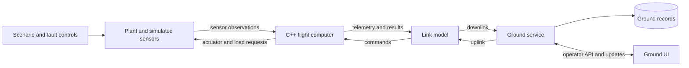

# 01 — Phase 0: establish the project

## Outcome

Finish Phase 0 with a repository organization, a short decision record, an agreed first increment, and a small set of conventions. You should be able to start Phase 1 without inventing project structure as you go. A final application architecture is not a Phase 0 deliverable.

## Repository strategy

**Recommendation: begin with one repository.** Flight software, ground software, protocol documentation, and scenarios will evolve together. A single change can update both endpoints and their shared contract, and a reviewer has one place to start.

| Option | Advantages | Costs | When to choose it |
| --- | --- | --- | --- |
| One repository | Atomic contract changes, common scenarios, simpler onboarding and release evidence | Several toolchains share a workspace | Recommended for this solo project |
| Separate flight and ground repositories | Independent releases and ownership | Protocol version coordination, dependency publishing, cross-repository test setup | Useful after distinct consumers or maintainers actually exist |
| Separate protocol repository/package | Reusable published contract | Release/version overhead before a second real consumer | Consider when external integration justifies it |

Splitting repositories later is feasible if component boundaries and contracts are clear. Separate processes do not require separate repositories.

## Suggested layout

The following is a destination layout, not a request to create empty scaffolding. Add a directory when it acquires a real responsibility. Choose exact names yourself.

```text
tiny-sat/
  README.md                 Project pitch, current status, eventual quick start
  docs/                     Specification, decisions, operational instructions
    decisions/              Your architecture decision records, added as needed
  flight/                   C++ flight application and its component tests
  simulation/               Plant, sensor, and scenario support as warranted
  ground/
    service/                Communications, command tracking, persistence
    ui/                     Operator interface
  protocol/                 Wire contract, message dictionary, golden fixtures
  scenarios/                Versioned nominal, fault, and impairment definitions
  tests/
    integration/            Checks involving multiple real components
    acceptance/             Phase and release scenarios
    fixtures/               Shared sample inputs with documented provenance
  tools/                    Your later build/run/inspection helpers
  config/                   Example local configuration, no secrets
  evidence/                 Small reviewed summaries, plots, demo instructions
```

An equally valid start is to keep simulation under `flight/` and separate it only when its role warrants it. Do not create a second simulator executable just because the diagram has a simulation box. Keep component-specific unit tests near the relevant component; reserve top-level test directories for interactions that genuinely cross boundaries.

Generated builds, dependency directories, local databases, bulk telemetry, temporary packet captures, and private machine settings should be ignored by version control. Commit small representative fixtures and result summaries. Provide a documented external location or release artifact for large evidence if you later need it.

## Logical responsibilities before deployment choices



These are responsibilities and information paths, not mandated processes or threads. Plant and flight may share one process initially. The required process boundary is between spacecraft execution and ground execution. The UI normally runs in a browser and communicates with the ground service rather than opening the spacecraft transport itself.

Preserve three boundaries in particular:

- **Observation boundary:** flight sees sensor observations; access to plant truth is reserved for the simulator and verification.
- **Transport boundary:** domain behavior should remain understandable when the local transport is eventually replaced.
- **Control boundary:** scenario controls alter the experiment; spacecraft commands ask flight software to act. The UI must identify which kind of control an action represents.

## Decisions to make now

Record short answers using [08 — Engineering decisions](08-engineering-decisions.md). A paragraph with alternatives and a reason is enough.

| Decision | Question to answer in Phase 0 | Reasonable starting point |
| --- | --- | --- |
| Repository boundary | One repository or several? | One repository |
| Learning scope | What is the first executable demonstration? | Battery and temperature evolution in a local C++ loop |
| Toolchain | Which C++ language level, compiler, build tool, and test runner will you actually use? | A supported local toolchain; select versions and record them |
| Target environment | Which environment must the first release support? | Your Mac; record hardware/OS when measuring timing |
| Time model | What is simulation time, what drives it, and how does it relate to real time? | Fixed simulation steps for model checks; a real-time runner for interactive use |
| State ownership | Who alone decides spacecraft mode and applies subsystem actions? | One logical flight state authority, regardless of execution model |
| Model fidelity | What physical effects are initially represented? | Battery energy balance, one thermal node, switchable payload |
| Evidence | Where will scenarios, selected targets, and result summaries live? | Versioned scenario definitions and small evidence summaries |

The time-model choice must state how model steps and task releases interact. Do not leave this at “use timestamps.” [02](02-spacecraft-behavior.md) defines the clock distinctions and [06](06-verification.md) defines timing measurements.

## Decisions to make just before their phase

| Before phase | Decide | Keep open until then |
| --- | --- | --- |
| 2 | Execution model, release/overrun policy, rates, fault thresholds, recovery policy | Event loop versus worker threads; scheduling implementation |
| 3 | Transport, wire encoding, size limits, integrity algorithm, message identity, initial ground-service language | UDP versus TCP, field widths, library choices |
| 4 | Ground API, UI framework, persistence engine, data/query limits | WebSocket versus polling, schema, chart library |
| 5 | Retry/expiry policy, replay rejection, deduplication retention, reconciliation, impairment ordering | Exact algorithm and queue representations |
| 6 | Final resource limits, storage failure behavior, evidence/run procedure | Packaging and CI details |

Phase 3 must reserve semantics for identity, boot/session boundaries, and expiration even if Phase 5 completes their robust enforcement. Otherwise Phase 5 may require a deliberate protocol revision. Such a revision is acceptable; make it explicit.

## Important choices and their tradeoffs

### One execution loop or several workers

A single loop makes state ownership and deterministic ordering easier to understand. Blocking work can delay everything. Workers can isolate slow operations but introduce synchronization, queue ownership, and shutdown problems. Choose based on actual responsibilities; task frequency does not imply one thread per task.

Keep network waits, UI operations, and database operations from blocking the flight state authority without a defined bound. State consistency is a requirement; a particular concurrency pattern is not.

### UDP or TCP for the spacecraft link

UDP makes individual application messages and deliberate loss easy to expose, but delivery, ordering, duplication, and flow limits need explicit handling. TCP supplies an ordered reliable byte stream; you still need framing and application-level command results. To simulate lost commands above TCP, the impairment layer must deliberately discard complete application messages. These transport characteristics are described in [RFC 8085](https://www.rfc-editor.org/rfc/rfc8085.html#section-3.3).

**Recommendation:** UDP over loopback is a useful learning choice for this project's unreliable-link behavior. TCP remains valid if you document where impairment occurs and what reliability you are studying. Keep fragmentation and bulk transfer outside the first protocol version.

### Ground-service language and persistence

Python can keep networking and storage experimentation compact. C++ can deepen reuse of your systems-language work, at the cost of learning more infrastructure at once. A local embedded database is a reasonable initial persistence direction. You choose the actual stack; a distributed service platform is unnecessary for the initial scope.

### Build or adopt a flight framework

Build a small flight executive yourself if implementing scheduling and command handling is the learning objective. Study established systems for vocabulary and tradeoffs. Adopting a complete framework is a legitimate later comparison, but it changes which parts of the project are your work. The first-release specification does not require a framework.

## Phase 0 completion gate

- Record the decisions in the “now” table, including any assumptions you expect to revisit.
- Identify the logical owners of plant truth, sensor observations, spacecraft mode, and ground records.
- Select Phase 1 scope and the model's units and initial conditions.
- Choose where later protocol and scenario contracts will be documented.
- Describe the intended local build/run workflow in plain language; add verified commands as you implement it.
- Confirm that Phase 1 can be completed without the UI, database, network, or hardware.

Do not spend Phase 0 designing every class or populating every future directory. Its purpose is to remove the first blockers and make your assumptions visible.
